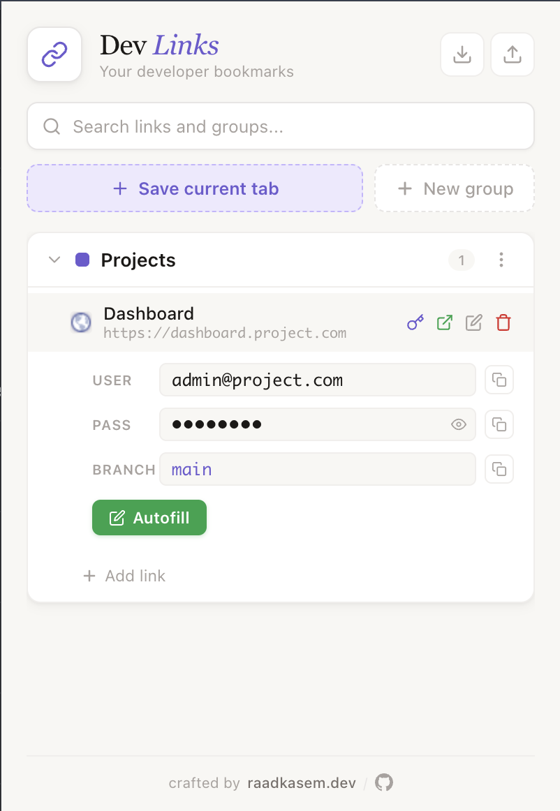
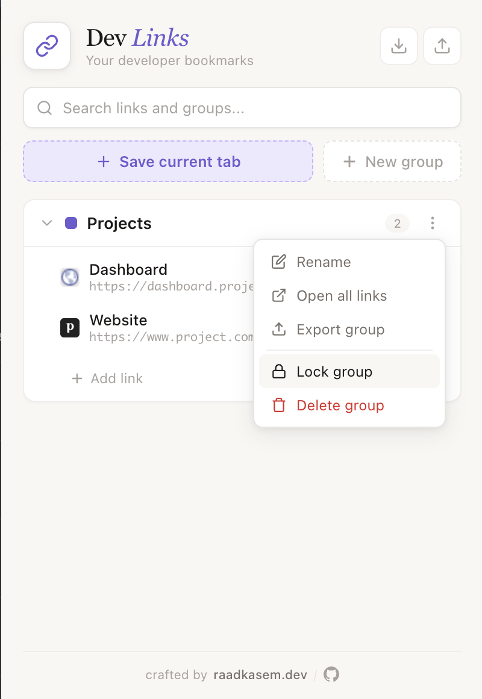
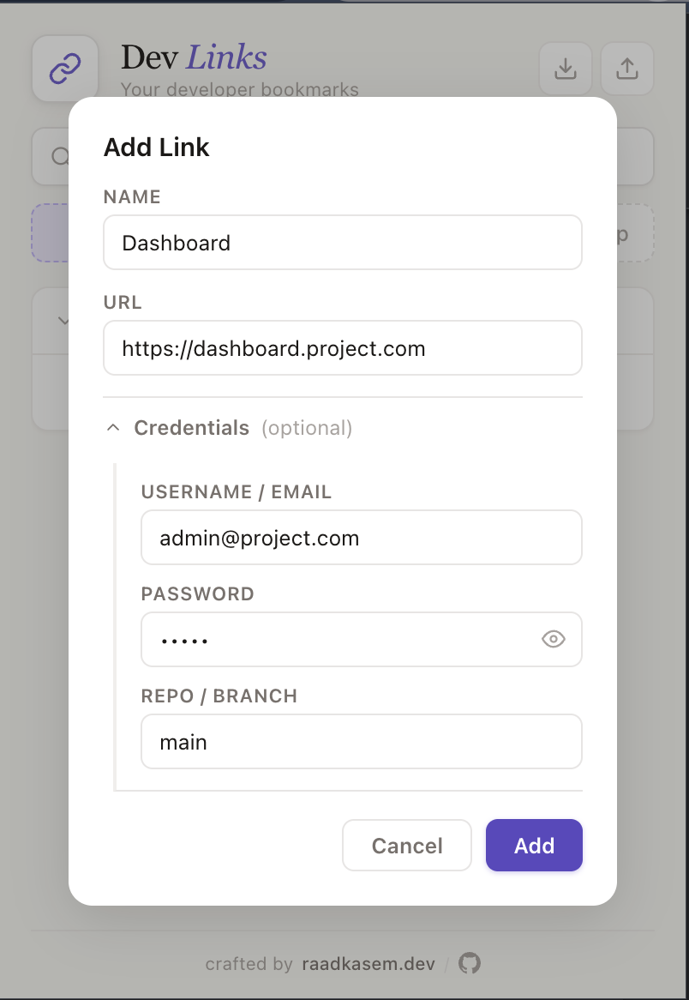
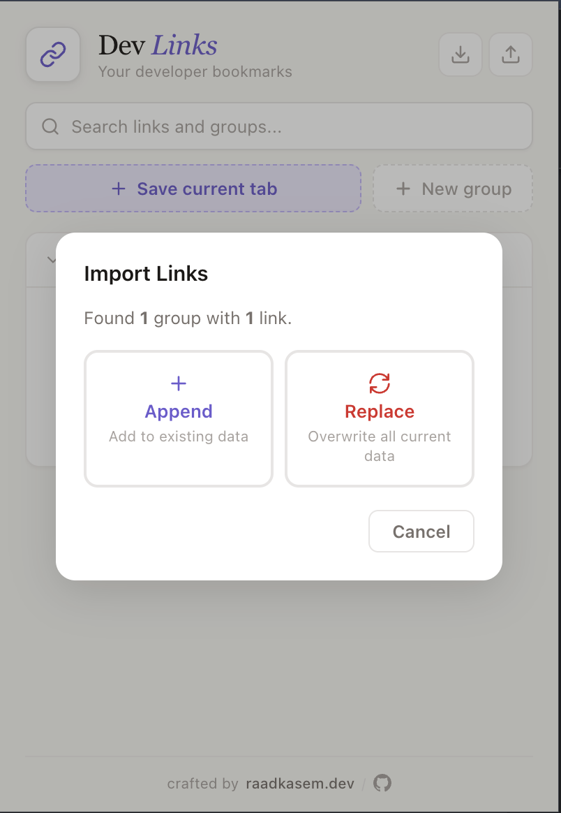

# Dev Links Bookmark

[](https://github.com/raadkasem/dev-links-bookmark/releases/latest)


Chrome extension to organize your developer links into groups — save, search, lock, and open them instantly.

**Latest version: [v1.2.0](https://github.com/raadkasem/dev-links-bookmark/releases/tag/v1.2.0)** · [Download extension ZIP](https://github.com/raadkasem/dev-links-bookmark/releases/download/v1.2.0/dev-links-v1.2.0.zip)

## What's new in v1.2.0

- **Export for 1Password:** choose JSON backup or a locally generated CSV from the export button. Includes all links, exact credentials, group names, branches, legacy notes and snippets. [Import instructions](#import-into-1password).
- **Careful credential handling:** proper CSV quoting preserves Unicode, password whitespace and multiline snippets. The export dialog warns that files are unencrypted and should not be opened in a spreadsheet.
- **Accessible export chooser:** keyboard focus, Escape/Cancel support and an empty-data state, without changing the main layout or requesting new permissions.
- **Compatibility and checks:** existing JSON backups and group exports are unchanged; 50 automated tests and an isolated Chromium smoke test cover the extension and both download formats.

See [CHANGELOG.md](CHANGELOG.md) for earlier releases, including v1.1.2's safety fixes and rendering optimizations.

## Screenshots

<p align="center">
  
  
  
  
</p>

## Features

- Create groups with color labels (e.g., "Projects", "DevOps", "Personal")
- Add, edit, and delete links with URL validation
- Credentials per link: username/email, password (masked with reveal toggle), repo/branch
- Branch field with autocomplete suggestions (main, develop, staging, production, etc.)
- Inline credentials card — click any link to expand, with copy buttons per field
- Autofill button — fills editable login fields only on the saved URL's exact origin (protocol, host and port)
- Code snippets per link — repeater field for storing commands (Docker, CLI, etc.) with multiline support
- Each snippet has a one-click copy button
- Separate `</>` toggle icon to expand/collapse snippets independently from credentials
- Save current HTTP/HTTPS tab to an unlocked group
- Search across all groups, links, and URLs
- Open all links in a group in background tabs
- Drag and drop to reorder groups and links between groups
- Lock groups to prevent edits, deletions, link duplication and drag-and-drop changes
- Delete protection — confirm dialog for links, type "Delete" for groups with links
- Export all data or a single group as organized JSON
- Export for 1Password as CSV, with a plaintext-password warning
- Export then Delete option for safe group removal
- Validated JSON import with Append or Replace mode (up to 10 MB); preserves lock/collapse state
- Favicons auto-loaded for each link
- Collapsible groups (accordion style)
- Elegant light theme UI

## Export Format

**Security:** credentials are stored locally and exported in **plain text**, not encrypted. The password below is only an example; actual exports contain the full saved password. Treat exports as sensitive files. Group locking prevents accidental changes; it is not encryption or access control. Favicons are requested from Google's favicon service using each link's hostname.

The JSON `version` field is the export schema version (`1.0`), independent of the extension release version.

```json
{
  "exportedAt": "2026-03-30T12:00:00.000Z",
  "version": "1.0",
  "totalGroups": 1,
  "totalLinks": 1,
  "groups": [
    {
      "name": "Projects",
      "color": "#6D5BD0",
      "collapsed": false,
      "locked": false,
      "links": [
        {
          "name": "Dashboard",
          "url": "https://dashboard.project.com",
          "username": "admin@project.com",
          "password": "****",
          "branch": "main",
          "snippets": [
            { "code": "docker-compose up -d" },
            { "code": "docker logs -f app" }
          ]
        }
      ]
    }
  ]
}
```

## Import into 1Password

Available in v1.2.0 and later. No 1Password API key or extension permission changes are needed.

1. Click the header **Export** button, then **Export for 1Password**. Save `dev-links-1password.csv` somewhere private.
2. Sign in to **1Password.com**, choose your name at the top right, then **Import data → CSV File**. Select the CSV and the destination vault.
3. Review the rows. Choose **Login** for links with credentials, or **Secure Note** for bookmark-only links. If the column-header row appears as an item, choose **Ignore Row** for it.
4. Label the columns **Title**, **Website**, **Username**, **Password**, and **Notes**. Bookmark-only URLs also appear in Notes, so they are kept when importing as Secure Notes; unused columns can be ignored for those rows.
5. Finish the import and check the saved URLs, credentials and notes before deleting the unencrypted CSV.

Each link becomes one row, including links in locked/collapsed groups and links hidden by search. Group names, branches, legacy notes and numbered snippets are stored in Notes. Empty groups, group colors, locks and collapse settings do not transfer; groups do not automatically become 1Password vaults or tags. This is a one-time export, not synchronization. Keep a JSON backup if you want to restore Dev Links itself.

CSV is generated locally without contacting 1Password or needing an API key. It preserves Unicode, commas, quotes, password whitespace and snippet line endings. **Do not open or resave it in a spreadsheet app:** spreadsheets can alter credentials or interpret formula-like values. Protect the file from sharing or cloud backups, and delete it after verifying the import. See [1Password's CSV import guide](https://support.1password.com/import-1password-com/) for the current importer steps.

## Install

1. Download and extract the [v1.2.0 extension ZIP](https://github.com/raadkasem/dev-links-bookmark/releases/download/v1.2.0/dev-links-v1.2.0.zip), or clone this repo
2. Open `chrome://extensions`
3. Enable **Developer mode**
4. Click **Load unpacked** and select the folder containing `manifest.json`

**Updating an unpacked installation:** export a JSON backup first, replace the extension files in the same installation folder, then click **Reload** for Dev Links in `chrome://extensions`. Do not remove the installed extension or load it from a different folder if you want to keep its existing storage.

No build step is needed. The extension uses only `storage`, `activeTab` and `scripting` permissions; it does not request access to all websites. Autofill requires opening the popup from the toolbar on the website you want to fill. Embedded cross-origin login forms and protected browser pages are not supported.

## Development and checks

Node.js 20 or newer is needed only for development; there are no runtime dependencies.

```sh
npm ci
npm test
npm run benchmark
```

The benchmark compares DOM rendering against `v1.1.1` using 500 links, three snippets per link and half the groups collapsed. Its jsdom timings are synthetic, not browser responsiveness measurements.

For an isolated, headless Chromium smoke test using the real unpacked extension:

```sh
npx playwright-core install chromium
npm run test:browser
```

The browser test uses its own temporary profile and fixture data, never your installed extension's storage. An existing Chromium-for-Testing binary can be selected with `CHROME_PATH`; set `EXTENSION_PATH` to test an extracted release ZIP instead of the working tree. Tests cover real extension storage, JSON import/export, 1Password CSV downloads, dialog layout/keyboard focus, locking and drag-and-drop. These checks do not import into a live 1Password account. Toolbar-granted `activeTab` access and site-specific autofill should also be checked manually before publishing.

## Release workflow

- `main` tracks the latest stable, tagged release.
- Develop fixes on `fix/*` or features on `feature/*` branches.
- Prepare and validate each release on `release/<version>` (for example, `release/1.2.0`), updating `manifest.json`, this README and `CHANGELOG.md`.
- Merge the completed release into `main`, tag that commit as `v<version>`, and push `main`, the release branch and the tag.
- Publish a GitHub release with a ready-to-load ZIP containing only the extension files, README, changelog and license—not development dependencies or tests. Run the browser smoke test against the extracted ZIP before publishing.

## License

[MIT](LICENSE)

## Author

**Raad Kasem** — [raadkasem.dev](https://raadkasem.dev) · [GitHub](https://github.com/raadkasem)
